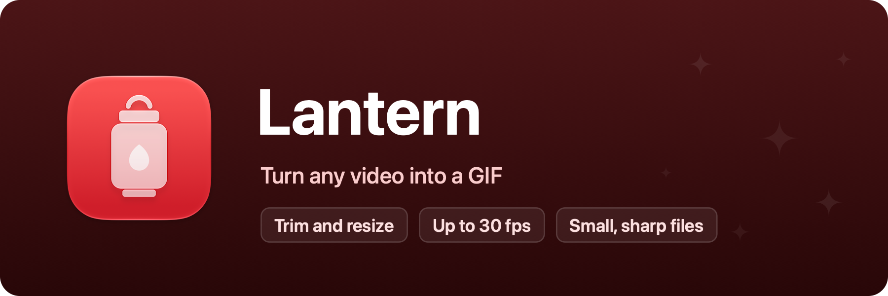

<p align="center">
  
</p>

# Lantern

Turn any video into a small, sharp GIF. Part of [Domus](https://domus-apps.com).

A lantern is the glazed structure on a roof that lets light into the rooms
below, and the magic lantern threw moving pictures onto a wall long before
film. Lantern makes the moving picture that plays anywhere: a GIF.

## How it works

Open Lantern and drop a video on its window or paste one you copied in Finder
(⌘V), or drop it on Lantern in the Dock, choose File › Open Video (⌘O), or
Control-click a video in Finder and pick Open With › Lantern or Services ›
Make GIF with Lantern. Each video opens in its own editor, and the drop window
comes back when the last one closes; File › New Window (⌘N) brings it up any
time. Lantern stays in the Dock when its windows are closed, so you can keep
dropping videos on its icon.

Choose a size (100, 75, 50, or 25 percent, or a custom width), a frame rate
(30, 20, 15, or 10 fps), how it plays (Loop, Play Once, or Bounce, which
plays forward and then backward), and a spot on the quality slider.
Screen recordings made on macOS often carry a thin gray line around their
edges, and sometimes a black one on the left and right. When Lantern finds
them, a Remove recording border switch appears that cuts those pixels off.
These choices sit in an
inspector beside the player, as in Photos' edit mode. Above the player, the
crop button frames the part of the picture to keep (drag a corner, an edge,
or the whole frame, then Done, or Esc to leave it as it was), and the
scissors open its own trim bar. Lantern encodes in the background as you
change things and shows the exact file size at the top of the inspector when
it is done. Save writes the GIF next to the
video (or to the Desktop, a folder you pick, or asks each time), and Copy puts
both the file and the GIF on the clipboard.

GIFs come from Lantern's own encoder (`LanternGIF`). It picks one palette for
the whole clip (a frame that palette suits badly, as in camera footage, gets
its own), stores only the part of each frame that changed, keeps flat
colors exact and dithers only gradients and photos, and toward the small end
of the slider lets the compressor reuse colors that are close enough. Screen
recordings shrink the most. GIF timing counts in hundredths of a second, so
frame delays are spread to keep the total length right at every frame rate.

## Development

```sh
./Scripts/dev.sh      # rebuild-and-relaunch loop
./Scripts/test.sh     # unit tests
./Scripts/bundle.sh   # assemble build/Lantern.app
```

`Lantern --debug-export <video> <out.gif> <fps> <percent> <quality> [<start> <end>] [--playback loop|once|bounce] [--remove-border]`
encodes a file through the app's exporter without any UI and prints the time
and size. Open With and the Services entry are registered from the bundle, so
test them with a bundled build. Requires macOS 26 or later.

## License

MIT, see [LICENSE](LICENSE). Bundled third-party software and its licenses are listed in [THIRD-PARTY-NOTICES.md](THIRD-PARTY-NOTICES.md).
